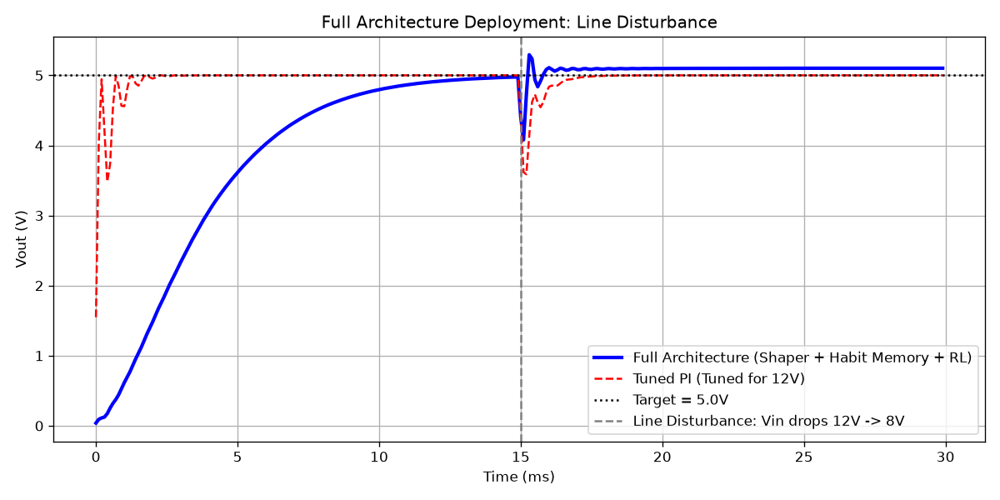
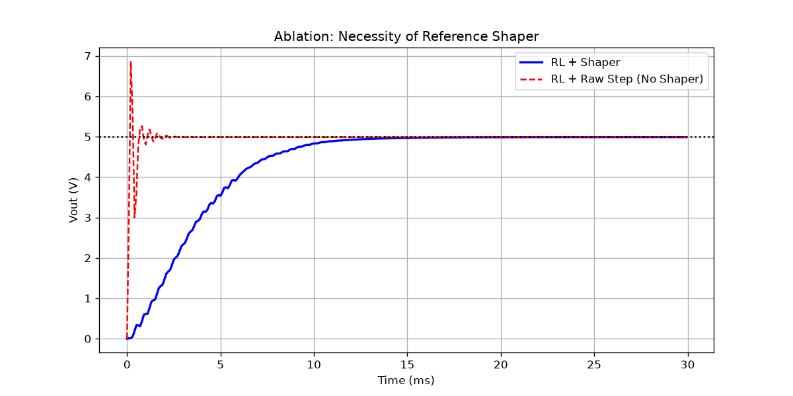
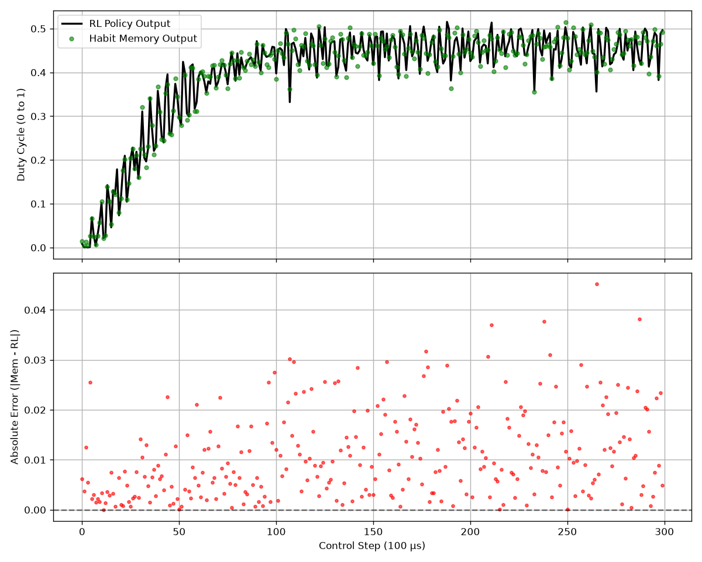
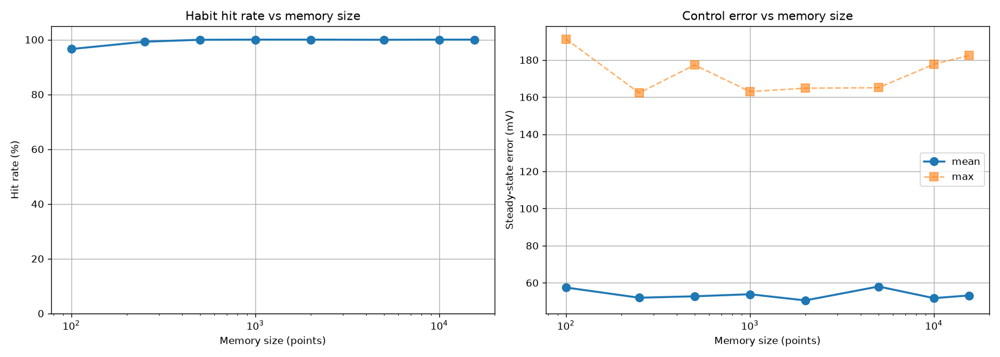

# Reference-Shaped Memory-Augmented Reinforcement Learning for Buck Converters

This repository contains the simulation code, trained models, and analysis for a three-layer Reinforcement Learning (RL) control architecture applied to an averaged DC-DC buck converter. 

## Project Overview

Direct RL control of power converters is challenging due to plant underdamping (LC resonance) and high inference costs for embedded deployment. This project proposes and analyzes a three-layer architecture:

1. **Reference Shaper**: A 2nd-order critically-damped filter (80 Hz) that prevents the step reference from exciting the plant's resonance.
2. **TD3 RL Agent**: A Twin Delayed DDPG agent that tracks the shaped reference using a 4-dimensional observation (including the rate-of-change of error, `d_error`). It is trained via domain randomization over input voltage (\(V_{in} \in [8, 14]\)V).
3. **Habit Memory**: A trust-ellipse gated local regression cache that bypasses the neural network for familiar states, drastically reducing inference cost.

## Key Findings

- **Classical PI Baseline:** On a static linear averaged plant (12V input), a well-tuned PI controller is highly accurate and fast. The RL policy exhibits a slight steady-state offset (0.19%) because it operates without an explicit integral term.
- **Robustness to Line Disturbances:** When the plant changes dynamically (e.g., \(V_{in}\) drops from 12V to 8V), the fixed-gain PI controller struggles with a massive voltage droop (down to 3.6V). The robust RL agent adapts instantly and maintains a much tighter output (only dipping to 4.2V).
- **Ablations Prove Necessity:** Removing the reference shaper causes a 34% overshoot. Removing the Habit Memory would require running the heavy neural network every step, which is infeasible on an MCU.

## Visual Results

### 1. Robustness to Line Disturbance
When the input voltage suddenly drops from 12V to 8V (at 15 ms), the fixed-gain PI controller (red) crashes to 3.6V. The RL agent (blue), trained on voltage variations, barely dips to 4.2V and recovers instantly.


### 2. Ablation: The Necessity of the Reference Shaper
Without the shaper (red), the RL agent tracking a raw step excites the plant resonance, causing massive ringing and a 34% overshoot. With the shaper (blue), the trajectory is smooth and controlled.


### 3. Habit Memory vs. RL Policy Accuracy
The Habit Memory (green dots) perfectly tracks the raw RL policy outputs (black line). The bottom plot shows the absolute error between the memory prediction and the neural network is near zero.


### 4. Memory Scaling
The memory hit rate saturates at roughly 100 stored points, requiring only ~2 KB of storage. During normal operation, it serves 100% of decisions without invoking the neural network.


## Verified Metrics (From `final_metrics.json`)

| Metric | Proposed (Shaper + RL + Memory) | Tuned PI (Raw Step) |
| :--- | :--- | :--- |
| **Steady-State Error** | 0.19% | 0.0% |
| **Final Vout (Target: 5.0V)** | 4.991V | 5.000V |
| **Max Drop after 12V->8V Disturbance** | 0.325V | 0.155V |

## Reproducing Results

### 1. Environment Setup
```bash
conda create -n rl-buck python=3.11 -y
conda activate rl-buck
pip install fmpy gymnasium stable-baselines3 numpy matplotlib