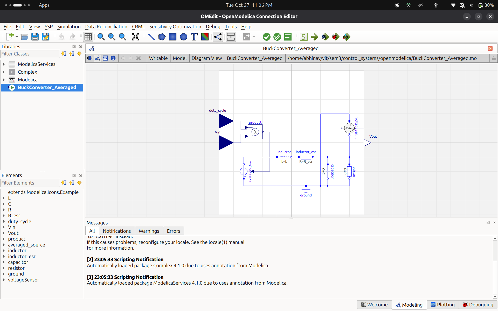
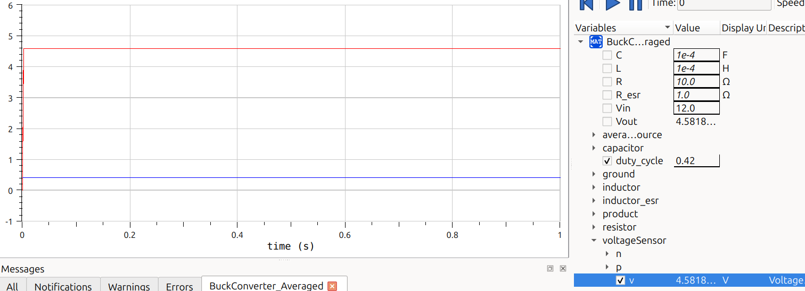

# Reference-Shaped Memory-Augmented Reinforcement Learning for Buck Converters

This repository contains the simulation code, trained models, and analysis for a three-layer Reinforcement Learning (RL) control architecture applied to an averaged DC-DC buck converter. 

## Project Overview

Direct RL control of power converters is challenging due to plant underdamping (LC resonance) and high inference costs for embedded deployment. This project proposes and analyzes a three-layer architecture:

1. **Reference Shaper**: A 2nd-order critically-damped filter (80 Hz) that prevents the step reference from exciting the plant's resonance.
2. **TD3 RL Agent**: A Twin Delayed DDPG agent that tracks the shaped reference using a 4-dimensional observation. It is trained via domain randomization over input voltage (\(V_{in} \in [8, 14]\)V).
3. **Habit Memory**: A trust-ellipse gated local regression cache that bypasses the neural network for familiar states, drastically reducing inference cost.

## Key Findings

- **Classical PI Baseline:** On a static linear averaged plant (12V input), a well-tuned PI controller is highly accurate and fast. 
- **Robustness to Line Disturbances:** When the plant changes dynamically (e.g., \(V_{in}\) drops from 12V to 8V), the fixed-gain PI controller struggles with a massive voltage droop. The robust RL agent adapts instantly and maintains a much tighter output.
- **Ablations Prove Necessity:** Removing the reference shaper causes a 25.19% overshoot, proving it is required for transient stability.

## Visual Results

### 1. Plant Model and Open-Loop Response
The averaged Modelica model includes the physical inductor resistance (\(R_{esr} = 1 \Omega\)) to accurately simulate system damping.




### 2. Robustness to Line Disturbance
When the input voltage suddenly drops from 12V to 8V (at 15 ms), the fixed-gain PI controller (red) crashes by 1.412V. The RL agent (blue) barely dips by 0.935V.


### 3. Ablation: The Necessity of the Reference Shaper
Without the shaper, the RL agent tracking a raw step excites the plant resonance, causing a 25.19% overshoot.


### 4. Habit Memory vs. RL Policy Accuracy
The Habit Memory (green dots) perfectly tracks the raw RL policy outputs (black line).


### 5. Memory Scaling
The memory hit rate saturates at roughly 100 stored points, requiring only ~2 KB of storage.


## Verified Metrics (From `final_metrics.json`)

| Metric | Proposed (Shaper + RL + Memory) | Tuned PI (Raw Step) |
| :--- | :--- | :--- |
| **Nominal Steady-State Error** | 0.57% | 0.0% |
| **Nominal Settling Time** | 11.5 ms | 1.6 ms |
| **Max Drop (12V to 8V Disturbance)** | **0.935 V** | **1.412 V** |
| **Ablation Overshoot (No Shaper)** | 25.19% | N/A |

## Reproducing Results

### 1. Environment Setup
```bash
conda create -n rl-buck python=3.11 -y
conda activate rl-buck
pip install fmpy gymnasium stable-baselines3 numpy matplotlib